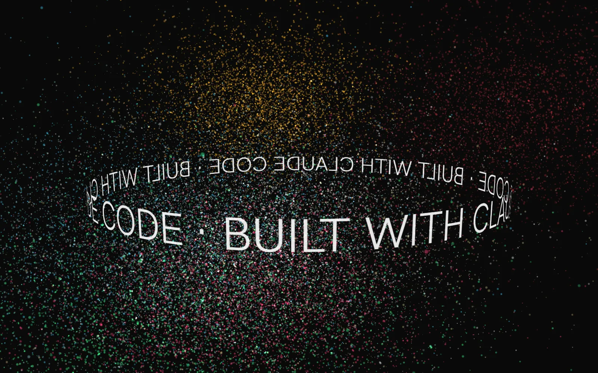
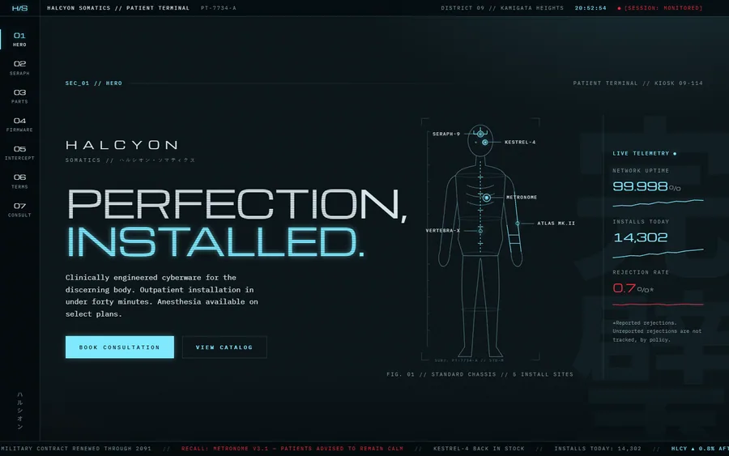
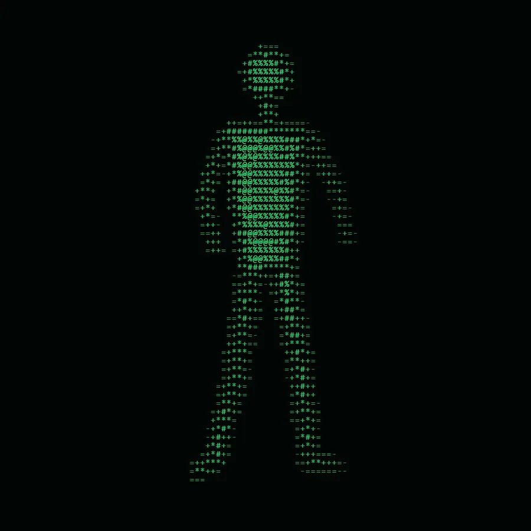
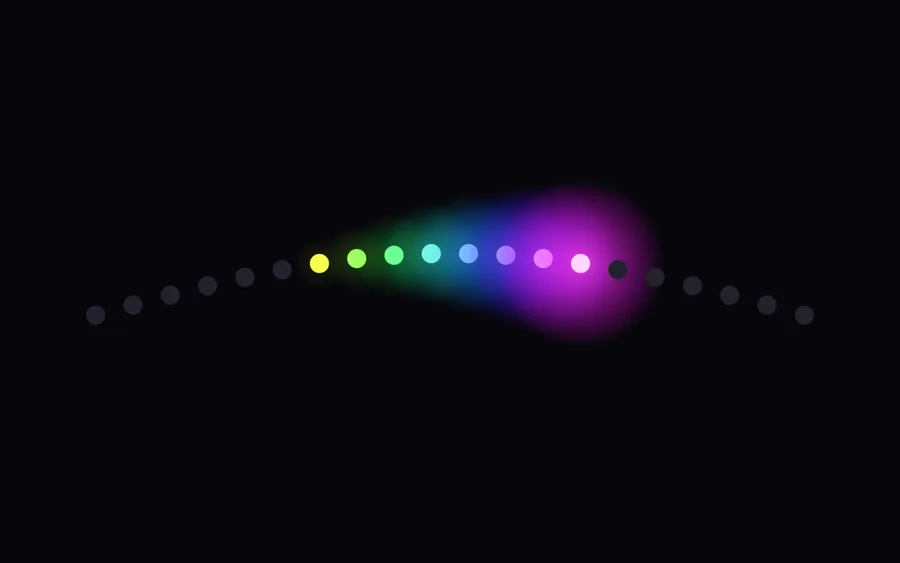
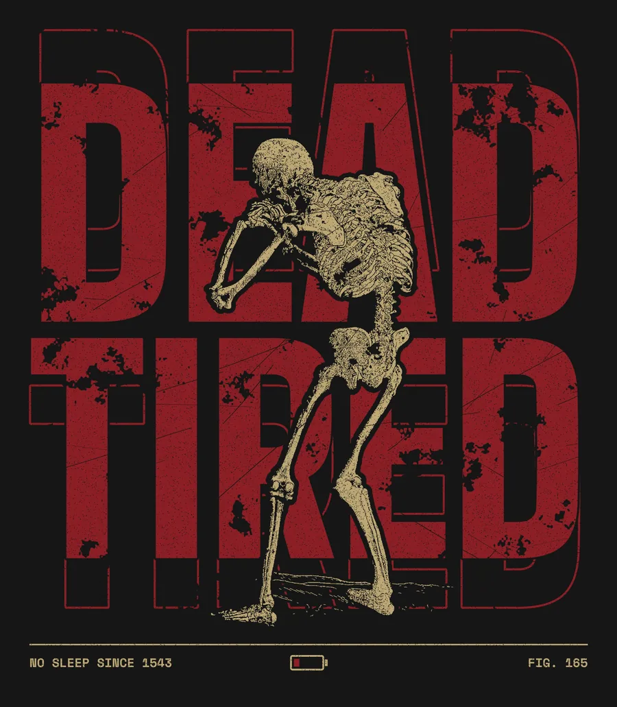

# Portfolio



The projects I've built with Claude Code, as one scrolling site. Each project is a chapter with its own 3D world: the HALCYON body drawn in points of light, the DEAD TIRED print coming apart in layers, the Pico's LED strip running the real light show, and my Raspberry Pi build drawn in green ASCII.

The site isn't online yet. You can run it on your own computer (see [Run it](#run-it)).

## The projects

<table>
  <tr>
    <td width="50%" valign="top">
      <br>
      <strong>HALCYON SOMATICS</strong> · September 2026<br>
      A fake cyberware megacorp, with the horror hidden in the fine print. I chose the direction and the mood; Claude Code wrote the spec and the plan, then built the page.
    </td>
    <td width="50%" valign="top">
      <br>
      <strong>ASCII Mirror</strong> · in progress<br>
      A camera that redraws the people walking past as live ASCII art. Claude Code modelled my Raspberry Pi 5 setup and designed the camera mount, and I printed it. The software on the Pi is next.
    </td>
  </tr>
  <tr>
    <td width="50%" valign="top">
      <br>
      <strong>Pico Light Show</strong> · September 2026<br>
      Seven LED effects for a 20-pixel strip on a Raspberry Pi Pico. Claude Code wrote the first one, a bouncing rainbow comet, and fixed a colour bug. I wrote the other six.
    </td>
    <td width="50%" valign="top">
      <br>
      <strong>DEAD TIRED</strong> · November 2026<br>
      A graphic tee: a skeleton from a 1543 anatomy book, too tired to stand up straight. I cut out and coloured the skeleton; Claude Code found the assets and composed the final layout when I asked.
    </td>
  </tr>
</table>

## About this site

Claude Code wrote this site's code. I picked the idea and the style, reviewed every milestone and asked for the changes I wanted. It started as a design spec and was built one milestone at a time, with tests at each step. The spec and every plan are in [`docs/superpowers/`](docs/superpowers/).

- **Works without 3D.** Every chapter has a still poster, and all the text is plain HTML, so the page still reads if WebGL is off or a world fails to load.
- **No requests to other sites.** The fonts are bundled with the site, and there are no analytics or trackers.
- **The camera mirror is opt-in.** In the ASCII Mirror chapter you can turn your webcam into live ASCII art. It only starts when you click, runs entirely in your browser, and never records or sends anything.
- **The Pico chapter runs the real show.** It's a JavaScript port of my `boot.py`, tested against the Python original frame by frame.
- **Reduced motion is respected.** With it turned on, the 3D worlds and smooth scrolling switch off and each chapter shows its poster.

Built with [Vite](https://vite.dev), [three.js](https://threejs.org) and [Lenis](https://lenis.darkroom.engineering), with Hanken Grotesk, JetBrains Mono, Michroma and Big Shoulders Display from [Fontsource](https://fontsource.org). Tests use [Vitest](https://vitest.dev) and [Playwright](https://playwright.dev), with [axe-core](https://github.com/dequelabs/axe-core) for accessibility.

## Run it

You need [Node.js](https://nodejs.org) 18.16 or newer.

```sh
npm ci
npm run dev
```

Then open http://localhost:5173.

| Command | What it does |
|---|---|
| `npm run dev` | Runs the site locally and reloads when files change |
| `npm test` | Unit tests |
| `npm run test:e2e` | Browser tests. They use Microsoft Edge by default; set `PW_CHANNEL=chromium` after `npx playwright install chromium` to use Playwright's own browser |
| `npm run check` | Checks the project list and that every file it names exists |
| `npm run build` | Builds the site into `dist/` |

The images and videos are committed as they are. The scripts that rebuild them (`npm run media` and the `video:` scripts) need my original source files, which aren't in this repo.

## How it fits together

| Path | What's there |
|---|---|
| `src/content/projects.js` | The project list. Every chapter, menu item and link comes from it |
| `src/worlds/` | One 3D world per file |
| `src/stage/` | The WebGL renderer, bloom and the transition between worlds |
| `src/ui/` | The chapter menu, video player, light-show controls, camera mirror and 3D model viewer |
| `src/lib/` | Small pure functions with unit tests, including the `boot.py` port in `src/lib/led/` |
| `public/projects/<id>/` | Each project's images, videos and code |
| `public/halcyon/` | A live copy of the HALCYON SOMATICS page |
| `tools/` | Scripts that build the media and run the checks |
| `tests/` | Unit tests (`tests/unit/`) and browser tests (`tests/e2e/`) |
| `CLAUDE.md` | Working notes for Claude Code, including how to add a project |
